# Email Queue System

**A multi-tenant email delivery platform that never loses a message and never exceeds a provider's rate.**
Users sign up, connect their own SMTP account and **declare the rate it allows**; the system accepts mail durably,
paces it to that rate, delivers it at-least-once, and learns from bounces, complaints and throttling on its own.

`Bun` · `TypeScript` · `BullMQ` · `Redis` · `MongoDB (replica set)` · `React 19` · `Docker`

| | |
|---|---|
| **Durable** | Every accepted email is in MongoDB (`w:majority`, inside a transaction) *before* the API answers `202`. Redis is a cache that may lose data; the reaper rebuilds anything it loses. |
| **Exactly the rate you declare** | A token bucket in Redis releases only as many jobs as the account's rate allows. Measured: **997/s** on a declared 1,000/s ceiling, 60,000 emails, 0 lost, 0 duplicated. |
| **Self-tuning** | An adaptive controller (slow start, ×0.7 on `421/451/4.7.x`, gentle probing, exponential pause, `Retry-After`) finds a provider's real limit and remembers it. |
| **Fair** | Each account has its own bucket and its own bulkhead, so one tenant's million-email campaign cannot starve another. |
| **Survives failure** | Verified under load: workers and relay SIGKILLed, Redis wiped, Mongo primary killed, Redis master killed. **0 emails lost.** Graceful stops never duplicate. |
| **Observable and sized** | Prometheus metrics, alert rules, and a load-test harness that reports **CPU and RAM per service against production-style limits**. |
| **Clean architecture** | Ports and adapters, SOLID, one composition root, core services unit-tested with fakes, HTTP layer tested against real MongoDB/Redis. |

## Live demo

**https://admin.tailc8948a.ts.net**: the production stack (3-node MongoDB replica set, Redis with Sentinel, API, relay,
workers, reaper) running on my own machine behind a Tailscale Funnel, so it can be offline when the machine is.

Try the whole flow in two minutes without giving it any real credentials:

1. **Register** an account on the site.
2. Get a free throwaway SMTP inbox at **[ethereal.email/create](https://ethereal.email/create)** (one click, no signup). It
   captures mail and shows it in a web page; nothing is ever delivered to a real address.
3. In **SMTP accounts → Add**, enter host `smtp.ethereal.email`, port `587` (leave "secure" off, it upgrades with
   STARTTLS), the username and password Ethereal gave you, that same address as the sender, and **declare a rate**
   (for example 5 per second). The rate you declare is the ceiling the system will respect.
4. In **Campaigns**, paste a few recipients (a CSV works; columns become `{{variables}}`), write a message and send.
5. Watch the **dashboard** pace the sending to your declared rate, then open the Ethereal inbox to read the delivered mail.

## Contents

[Live demo](#live-demo) · [Screenshots](#the-web-app) · [Architecture](#architecture) · [Guarantees](#guarantees) · [Quick start](#quick-start) ·
[Command reference](#command-reference) · [Configuration](#configuration) · [Load testing](#load-testing) ·
[Measured results](#measured-results) · [Code structure](#code-structure) · [Security](#security) ·
[Observability](#observability) · [Documentation](#documentation) · [Limits](#limits-worth-knowing)

## The web app

| | |
|---|---|
| 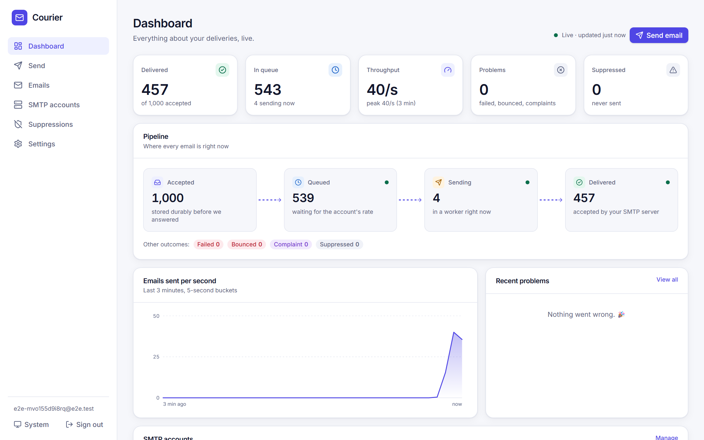 | 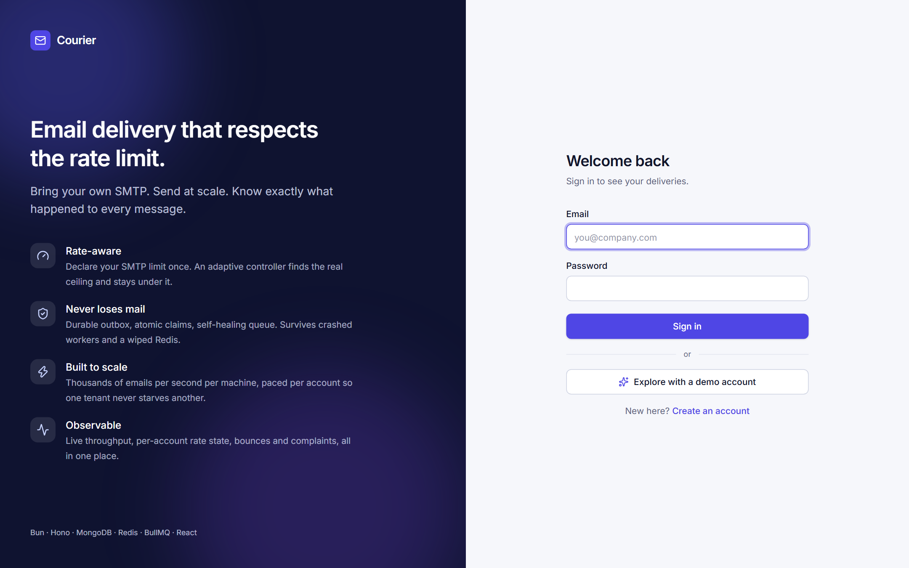 |
| **Live dashboard**: the pipeline, sent-per-second chart, and each SMTP account's declared ceiling vs the rate the adaptive controller is actually sending at. Here a 1,000-email campaign drains at exactly the declared 40/s. | **Sign in / demo**: one click creates a throwaway account wired to a fake SMTP server, so anyone can try it in seconds. |
| 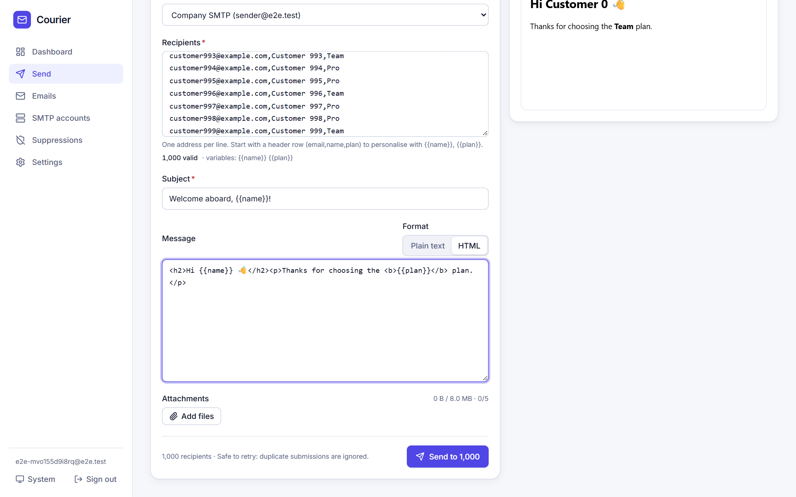 | 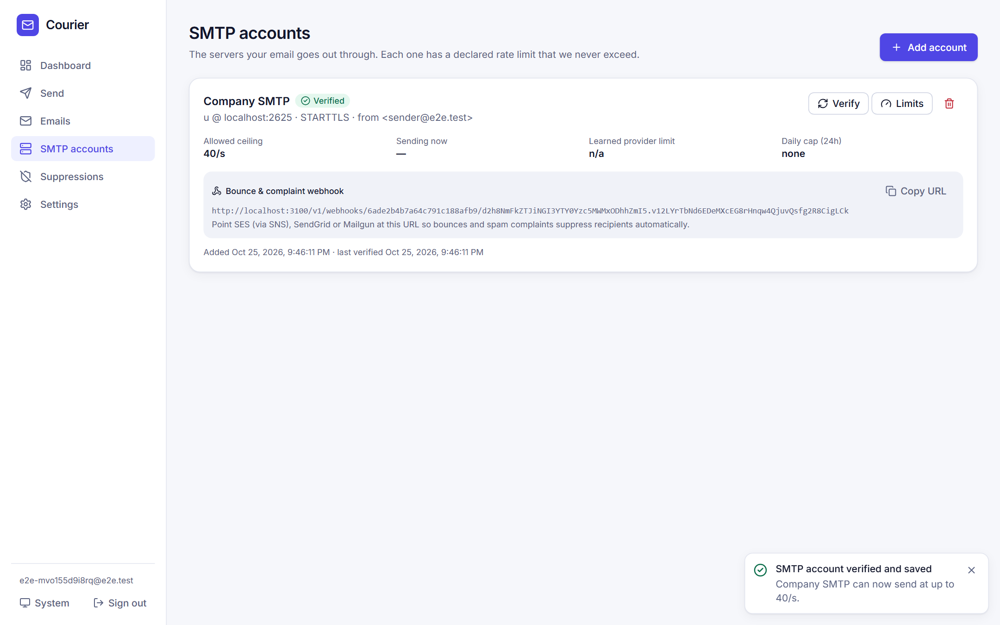 |
| **Campaigns**: paste a CSV, columns become `{{variables}}`, live preview, attachments, safe-to-retry sending. | **SMTP accounts**: you declare the provider's rate; known providers show their documented limits as a hint. |
| 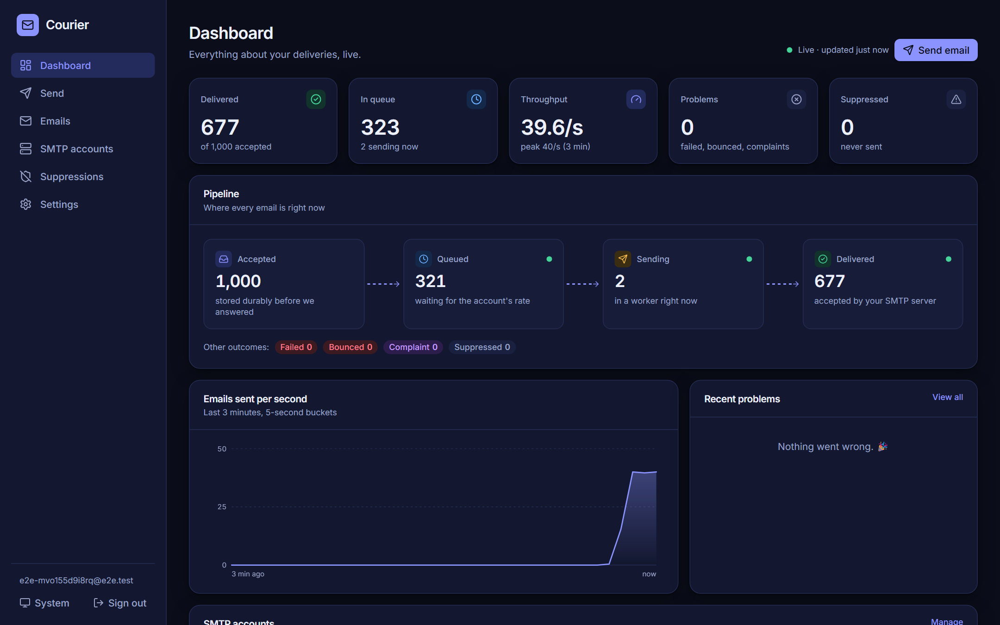 | 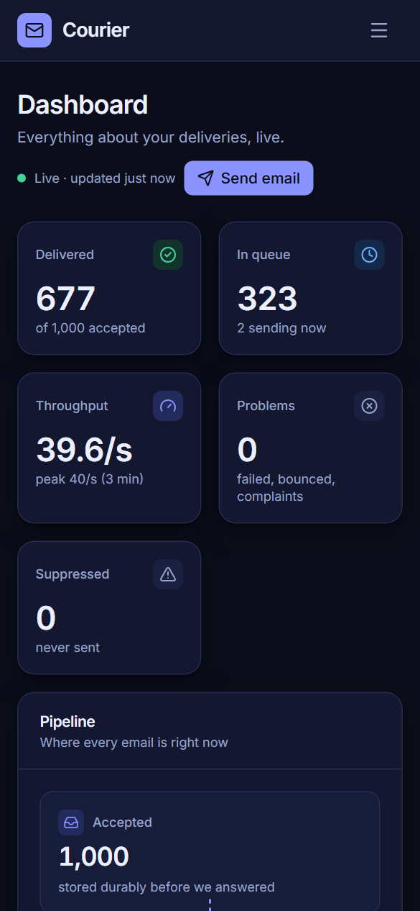 |
| **Dark mode** (system-aware). | **Responsive** down to phone width. |

React 19 + TypeScript (strict) + Vite + Tailwind, TanStack Query for server state, react-hook-form + zod for forms.
Every API response is **validated against a zod schema at the network boundary**; one `HttpClient` owns auth (in-memory
access token, HttpOnly SameSite=Strict refresh cookie, single-flight refresh on 401), and screens only talk to a typed
API gateway injected through context, so every screen is testable with a fake. Accessible by construction (native
`<dialog>`, labelled controls, live regions, reduced motion, colour never the only signal) and **checked by axe in a real
browser in light and dark**. Features live in `web/src/features/*`; shared primitives and design tokens in `web/src/shared`.

## Architecture

### System overview

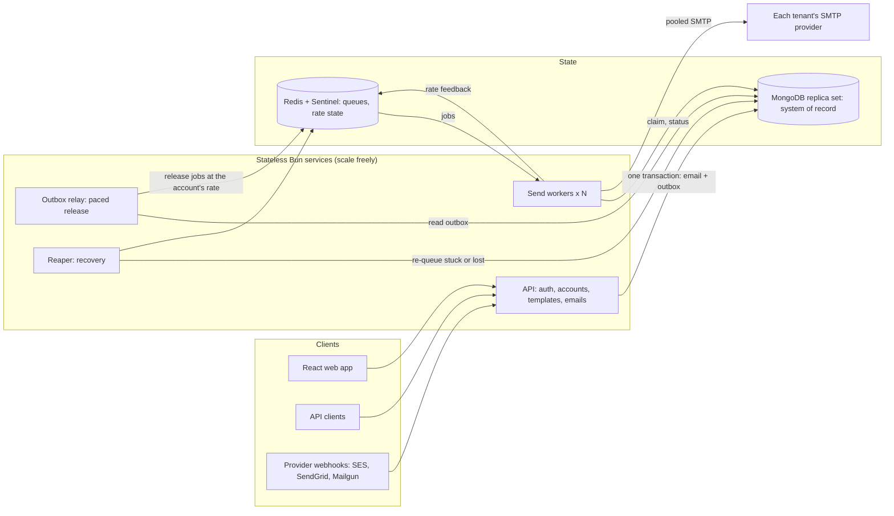

### The life of an email

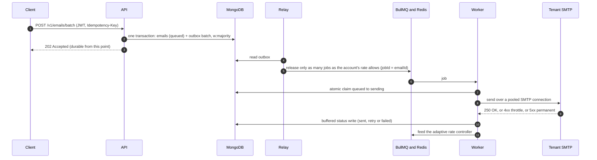

### Email states

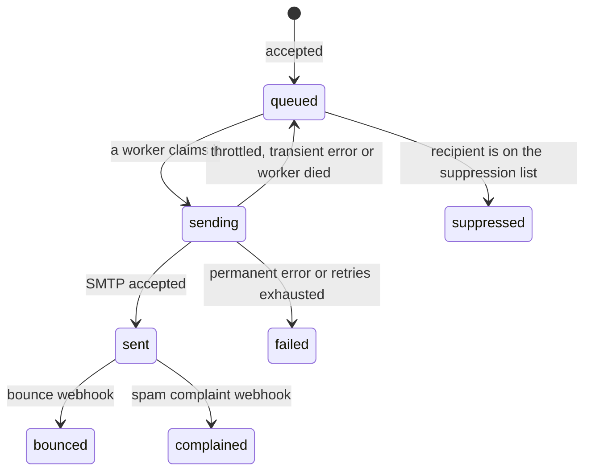

### How the rate is decided

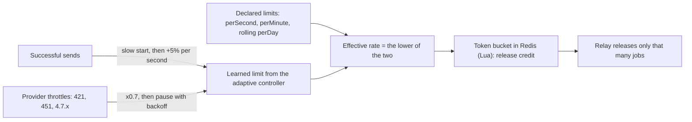

SMTP has no way to report a limit, so **the user declares it** (`limits.perSecond` and/or `perMinute`, optional `perDay`).
That is the hard ceiling. The daily cap is a **rolling 24 h window**, as at Gmail, Microsoft 365 and SES. The adaptive
controller only ever goes *below* the ceiling. Known providers get a documented-limits hint in the response, never a
silent default.

### Production topology

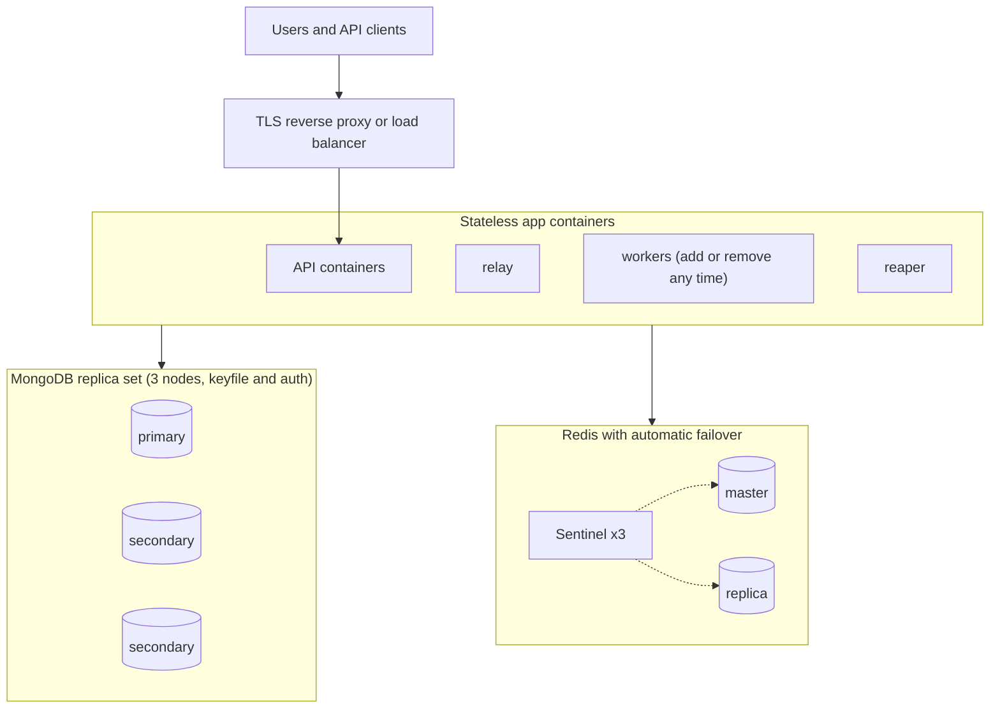

Lose any one Mongo node or the Redis master and the system keeps going (both verified under load).

### Data flow in detail

```
POST /v1/emails[/batch]   (JWT, Idempotency-Key, per-user rate limit)
   │  one MongoDB transaction, w:majority:  emails(status=queued) + outbox batch   <- durable before we answer 202
   ▼
ReleaseService (relay)    every 50 ms, per SMTP account:
   │  token-bucket credit (current adaptive rate, pause, rolling-24h cap) -> release only that many
   │  backpressure: pauses while a lane has > RELAY_MAX_READY ready jobs (the backlog stays in MongoDB)
   ▼
BullMQ  email-transactional | email-bulk          (jobId = emailId: re-release is idempotent)
   ▼
SendEmailService (N worker processes)
   bulkhead gate -> rate guard -> atomic claim (queued->sending) -> render -> pooled SMTP send
   ├─ success   -> buffered bulk status write; feeds the adaptive rate controller
   └─ failure   -> one Strategy per kind: throttle | quota | auth | transient | permanent
RecoveryService (reaper)
   ├─ `sending` too long (worker died)         -> re-queue
   ├─ released, still `queued`, no live job    -> re-create the job   (Redis lost data)
   └─ housekeeping: purge unused attachments
FeedbackService           provider webhooks (SES/SNS, SendGrid, Mailgun, generic) -> bounced / complained + suppression
UnsubscribeService        RFC 8058 one-click List-Unsubscribe on bulk mail
```

**The bulkhead.** Per SMTP account and per process, at most `2 x maxConnections` emails are *claimed* (marked
`sending`) at once; a limited number more wait unclaimed in memory; beyond that jobs are deferred. So a slow provider
(say 3 s per message) never leaves hundreds of emails wrongly marked `sending`, never lets the reaper's lease expire on
live mail, and can't occupy more than its share of a worker.

## Guarantees

| Guarantee | How |
|---|---|
| **No accepted email is lost** | MongoDB is the system of record, written `w:majority` in a transaction before `202`. Redis loss is repaired by the reaper (`RECONCILE_AFTER_MS`); `bun run requeue` forces it. |
| **At-least-once delivery** | A *graceful* stop never duplicates (verified). A hard kill can duplicate mails that were mid-send; they carry the same `Message-ID` and `X-Email-Id` so receivers can dedupe. No SMTP system can offer exactly-once. |
| **Safe retries** | `Idempotency-Key` on submit; BullMQ `jobId = emailId`, so re-releasing is a no-op; the claim `queued → sending` is atomic. |
| **Provider limits respected** | Declared ceiling is hard; the adaptive controller only goes lower; daily cap is a rolling 24 h window. |
| **Tenant isolation** | Every query is scoped to the user; each account has its own bucket, gate and connection pool. |
| **Backpressure** | The relay stops releasing while a lane has more than `RELAY_MAX_READY` (5,000) ready jobs; the backlog waits in MongoDB, so a spike never fills Redis. |

## Quick start

Requirements: [Bun](https://bun.sh) and Docker (for MongoDB and Redis).

```bash
docker compose up -d mongo redis         # MongoDB (replica set) + Redis
bun install && bun run web:install       # dependencies
bun run web:build                        # build the web app (the API serves it)
bun run dev                              # API + relay + reaper + 2 workers + fake SMTP server
# open http://localhost:3100  ->  "Explore with a demo account"
```

The demo account is wired to the bundled fake SMTP server, so you can send a campaign and watch the dashboard without
any real credentials. To send real mail, add your own SMTP account in the app and declare its rate.

## Command reference

Run everything from the repository root. Windows users can use `cmd` or PowerShell; `bun run dev` starts all services in
one terminal portably (a plain `&` does not background processes on Windows).

### Development

| Command | What it does |
|---|---|
| `docker compose up -d mongo redis` | Dev infrastructure (MongoDB replica set on `27017`, Redis on `6379`). |
| `cp .env.example .env` | Local configuration (see [Configuration](#configuration)). |
| `bun install` · `bun run web:install` | Server and web dependencies. |
| `bun run web:build` | Build the web app into `web/dist` (the API serves it on the same port). |
| `bun run dev` | API (`:3100`) + relay + reaper + workers + fake SMTP server, log lines prefixed by service, Ctrl+C stops all. `WORKER_PROCESSES=6 bun run dev` for more workers. |
| `WEB_DEV=1 bun run dev` | Same plus the Vite dev server with hot reload on `http://localhost:5173`. |
| `bun run api` · `relay` · `reaper` · `worker` · `sink` | Run a single service. |
| `WORKER_PROCESSES=4 bun run worker:cluster` | Several worker processes (default: half your cores). |
| `docker compose --profile app up --build -d` | The whole stack in containers (API on `:3100`, 3 workers, fake SMTP on `2525/2526`). |
| `.\dev.ps1 start -Workers 2 -SinkLimit 0 -SinkLatency 0` · `stop` · `status` | PowerShell helper that runs the services in the background. |

### Production

```bash
cp .env.prod.example .env.prod            # fill every secret: openssl rand -hex 32
docker compose -p eqprod -f docker-compose.prod.yml --env-file .env.prod up -d --build
docker compose -p eqprod -f docker-compose.prod.yml --env-file .env.prod up -d --scale worker=8   # more workers
```

3-node MongoDB replica set (keyfile + auth), Redis master/replica with three Sentinels and a password, healthchecked
stateless app containers with a 40 s drain period, memory limits. Put TLS termination in front of the API and set
`PUBLIC_BASE_URL`. Deploy, upgrade, backup and incident procedures: [docs/RUNBOOK.md](docs/RUNBOOK.md).

### Tests and checks

| Command | What it runs |
|---|---|
| `bun test` | Server tests (125): core services with fakes, HTTP layer against real MongoDB/Redis (needs `docker compose up -d mongo redis`). |
| `bun run web:test` | Web unit and component tests (65), including the API contract and accessibility helpers. |
| `bun run web:e2e` | Browser end-to-end tests (19, Playwright, incl. axe in light and dark) against the real stack. Start `bun run dev` first. `E2E_URL`, `E2E_SMTP_HOST`, `E2E_SMTP_PORT` redirect it. |
| `bun run web:screens` | Regenerates the screenshots in `docs/screenshots`. |
| `bun run typecheck` · `bun run web:typecheck` | TypeScript, strict. |
| `bun run lint` · `bun run format` · `bun run format:check` | Biome. |
| `bun run ci` | Everything CI runs: typecheck, lint, format check, server tests, web tests, web build. |
| `bun run smoke` | One real delivery end to end, verifying headers, MIME, unsubscribe, bounce handling. |

### Load and resilience testing

Full guide with every option, the capacity model, how to read the report and a scenario cookbook:
**[docs/LOAD-TESTING.md](docs/LOAD-TESTING.md)**. The essentials:

```bash
# quick throughput test against the dev stack
bun run loadtest -- --emails 100000 --per-second 20000

# production-style limits per container (CPU and RAM min/max), with resource usage in the report
bun run lt:up
bun run loadtest -- --docker --emails 60000 --per-second 1000 --connections 50 --report report.txt
bun run lt:down

# change the limits for a run (Windows cmd)
set WORKER_CPUS=0.5&& set WORKER_MEM=256m&& set WORKER_REPLICAS=8&& bun run lt:up

# a slow, jittery, changing or throttling SMTP provider
bun run loadtest -- --emails 300 --per-second 100 --sink-latency 3000 --sink-jitter 1500 --connections 10 --workers 2
bun run loadtest -- --emails 1200 --per-second 100 --connections 10 --workers 2 --timeline "0:200,5:3000,30:500,45:200"
bun run loadtest -- --emails 3000 --per-second 500 --timeline "0:0:0:50,20:0:0:10,40:0:0:0"

# break it while it runs (kills workers and relay, restarts or wipes Redis): must report 0 lost
bun run chaos -- --emails 60000
```

| Flag | Meaning |
|---|---|
| `--emails` · `--per-second` · `--connections` | How many to send, the declared rate ceiling, SMTP connections per worker. |
| `--sink-latency` · `--sink-jitter` · `--sink-limit` | The fake provider's per-message delay, random ± on it, and its own limit (replies `451` above it). |
| `--timeline "sec:latency[:jitter[:limit]],..."` | Change the provider **during** the run. |
| `--docker` · `--docker-project` | Use the resource-limited stack and sample CPU/RAM of its containers. |
| `--workers` | Worker processes running (for the capacity model; auto-detected with `--docker`). |
| `--report <file>` | Also save the report as text. |
| `--api` · `--sink-http` · `--sink-host` · `--sink-port` | Where things are, when they are not on the defaults. |

### Operations

| Command | What it does |
|---|---|
| `bun run requeue [-- --older-than <minutes>]` | Rebuild queue jobs from MongoDB for `queued` emails (after restoring a backup or losing Redis). Safe to repeat. |
| `bun run rotate-keys [-- --dry-run]` | Re-encrypt stored SMTP passwords under the current key after a key rotation. |
| `./deploy/backup.sh /backups` | MongoDB backup from a secondary (restore steps in the runbook). |

## Configuration

Set in `.env` (dev) or `.env.prod` (production); validated at startup, and the process refuses to start on a bad value.

| Variable | Default | Meaning |
|---|---|---|
| `MONGO_URL` · `MONGO_DB` | `mongodb://localhost:27017/?directConnection=true` · `emailq` | MongoDB (a replica set is required for transactions). |
| `REDIS_URL` | `redis://localhost:6379` | Redis; or set `REDIS_SENTINELS` (`host:26379,...`), `REDIS_MASTER_NAME`, `REDIS_PASSWORD` for failover. |
| `JWT_SECRET` | required, ≥ 32 chars | Signs access tokens (15 min). Rotating it signs everyone out. |
| `ENCRYPTION_KEY` | required, 64 hex chars | AES-256-GCM key for stored SMTP passwords. Rotate with `ENCRYPTION_KEY_ID` + `ENCRYPTION_OLD_KEYS` + `bun run rotate-keys`. |
| `LINK_SIGNING_KEY` · `LINK_SIGNING_OLD_KEYS` | derived from the encryption key | Signs unsubscribe links and webhook URLs; rotatable independently. |
| `PORT` · `PUBLIC_BASE_URL` | `3000` · none | Listen port; the public URL used in `List-Unsubscribe` links and webhook URLs. |
| `MESSAGE_ID_DOMAIN` | `emailq.local` | Domain in generated `Message-ID`s. |
| `ALLOW_PRIVATE_SMTP_HOSTS` | `false` | Allow SMTP hosts on private IPs (needed for the local fake server). **Keep `false` in production** (SSRF guard). |
| `WORKER_CONCURRENCY` | `200` | Jobs a worker process runs in parallel. |
| `RELAY_CONCURRENCY` · `RELAY_MAX_READY` | `4` · `5000` | Relay parallelism; ready jobs per lane before backpressure pauses release. |
| `SENDING_LEASE_MS` · `RECONCILE_AFTER_MS` | `120000` · `180000` | How long an email may stay `sending` / `queued` without a live job before the reaper repairs it. |
| `SEND_REQUESTS_PER_MINUTE` | `600` | Per-user cap on send requests. |
| `EMAIL_RETENTION_DAYS` | `30` | Emails (and their templates and attachments) are deleted after this. |
| `METRICS_TOKEN` | none | Protects `GET /metrics` (`Authorization: Bearer ...`), ≥ 16 chars. |
| `ALLOWED_ORIGINS` | none | Extra browser origins for the cookie session (for example the Vite dev server). |
| `DEMO_MODE` · `DEMO_SMTP_HOST` · `DEMO_SMTP_PORT` | `false` · `localhost` · `2525` | Demo account and campaign sender in the UI; where the demo SMTP account points. |
| `ACCESS_TOKEN_TTL_SEC` · `REFRESH_TOKEN_TTL_SEC` | 900 · 2,592,000 | Token lifetimes. |
| `AUTH_RATE_LIMIT_SCALE` | `1` | Multiplies per-IP limits on credential endpoints; tests raise it, leave at 1. |
| `LOG_LEVEL` | `info` | `debug`, `info`, `warn`, `error`, `silent`. |
| `WORKER_PROCESSES` · `WEB_DEV` | `2` (dev) / half the cores (`worker:cluster`) · off | Worker processes for `bun run dev` and `worker:cluster`; `WEB_DEV=1` adds the Vite dev server. |

## Load testing

The harness answers three questions with numbers: *how fast, how correct, and at what cost.* It sends emails through the
real pipeline to a fake SMTP server that counts what it receives (so loss and duplicates are ground truth, not the
app's own claim), compares the measured rate with what the setup **should** reach, and, in the Docker stack, reports CPU
and RAM per service against the limits it was given.

```
THROUGHPUT   steady-state 924/s   ██████████████████░░ 92% of the 1,000/s this setup should reach  ✔
DELIVERY     delivered 60,000 / 60,000 · lost 0 · duplicates 0 · failed 0
RESOURCES    service  ×  CPU MAX   AVG  PEAK  PEAK / MAX      RAM MIN – MAX     AVG    PEAK
             worker   8  0.50 core  24%  48%   ████████ 95%   256 MiB – 256 MiB  94 MiB 125 MiB
             mongo    1  2.00 core 114% 209%   ████████ 105%  1.00 GiB – 2.00 GiB 419 MiB 580 MiB
             whole stack: CPU avg 363% (≈ 3.6 cores) · peak 542%   RAM avg 1.35 GiB · peak 1.54 GiB
             cost: the app used 2.07 cores on average ≈ 447 emails/s per core
⚠ mongo used 105% of its CPU limit: it is the likely bottleneck, raise its cpus or add replicas
```

Use the *cost* line to size production: cores needed ≈ target emails/s ÷ emails/s per core, plus headroom. Everything is
explained in [docs/LOAD-TESTING.md](docs/LOAD-TESTING.md).

## Measured results

Laptop (12 logical cores, Docker Desktop), everything co-located, fake SMTP sink. Real throughput is bounded by your SMTP
provider; with a slow provider the cap is `min(declared rate, workers × connections ÷ latency)`.

| Scenario | Result |
|---|---|
| **Declared 1,000/s, 60,000 emails, 8 workers, Docker limits** | **924/s steady (92%), 0 lost, 0 duplicates**; whole stack 3.6 cores and 1.35 GiB on average, MongoDB the first part to reach its 2-core limit |
| **Declared 1,000/s, 60,000 emails, 4 workers, no limits** | **997/s steady (100% of the ceiling)**, 0 lost, 0 duplicates |
| API accept (batches of 1,000) | 15–30k emails/s |
| End-to-end, 3–5 worker processes | ~1–2.8k emails/s, 0 lost, 0 duplicates |
| Slow SMTP, 3 s per message, 10 connections, 2 workers | 6.7/s = exactly workers × connections ÷ latency; 0 lost, 0 duplicates |
| Same with ±1.5 s jitter; latency changing 0.2 s → 3 s → 0.5 s mid-run | 98% of the model, follows the change |
| 3-connection provider (Microsoft 365-like), 3 s per message | 2.0/s (100% of model); only 2 × 3 emails ever `sending`; 0 duplicates |
| Sink limited to 100/s, declared ceiling 2,000/s | The controller found the limit; 0.7% of sends rejected |
| SIGKILL workers + relay, Redis wiped, under load | 0 lost (duplicates only for mails mid-send at the kill) |
| Mongo primary killed, then Redis master killed, under load (80k mails) | 0 lost, 0 duplicates |
| Graceful worker stop (SIGTERM) under load (60k mails) | 0 lost, 0 duplicates, stop in ~1.5 s |
| MongoDB backup and restore | 140,007 emails restored identically |

## Code structure

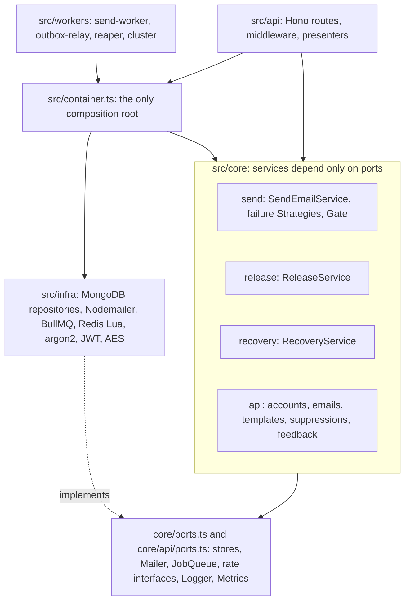

* `src/core/*`: application services depend only on **ports**: stores, `Mailer`, `JobQueue`, `AttachmentStore`,
  `AuditLog`, segregated rate interfaces (`SendRateGuard` / `SendRateFeedback` / `ReleaseBudget` / `RateStateReader`),
  `Logger`, `Metrics`. The core throws domain errors, never HTTP ones.
* `src/infra/*`: the adapters. `src/container.ts` is the only place that wires them; `src/api/*` is a thin HTTP layer
  (one error mapper, presenters, middleware).
* Patterns: Repository, Ports and Adapters, Strategy (failure handlers, feedback parsers), Bulkhead (`Gate`), Template
  Method (`runService`), Transactional Outbox, content-addressed storage, AIMD rate control.
* Core services are unit-tested with fakes; the HTTP layer against real MongoDB and Redis.

```
src/
  api/          HTTP: server, routes, middleware, session cookie, static web app
  core/         application services and ports (send, release, recovery, feedback, api)
  infra/        adapters: mongo repositories, queue, redis, security, nodemailer
  ratelimit/    Redis Lua token bucket, execution guard, adaptive rate state
  smtp/         error classification, provider presets, SSRF host guard, pooled transports
  workers/      send-worker, outbox-relay, reaper, cluster, buffered status writer
  loadtest/     fake SMTP sink, load test, docker resource monitor, report, smoke, chaos
  scripts/      dev launcher, requeue, rotate-keys
web/            React app (features, shared UI, tests, Playwright e2e)
deploy/         alert rules, backup script, mongo init
docs/           runbook, load testing guide, OpenAPI, screenshots
```

## Security

argon2id passwords; JWT access (15 min) plus rotating single-use refresh tokens with reuse detection; a password change
signs every session out; SMTP passwords AES-256-GCM with a versioned, rotatable key ring; SSRF guard on SMTP hosts and SNS
confirmation; per-IP limits on credential endpoints and a per-user limit on sending; header-injection-safe addresses,
subjects and attachment names; signed capability URLs for webhooks and unsubscribe (rotatable key); tenant isolation on
every query; audit log of security events; capability tokens never written to access logs; `/metrics` behind a token.

## Observability

Structured JSON logs with `X-Request-Id` correlation; Prometheus `/metrics` (cluster-wide counters, per-lane queue gauges,
oldest-waiting-job age); `/healthz` (process) and `/readyz` (MongoDB and Redis); alert rules in
[deploy/alerts.yml](deploy/alerts.yml). Alert on the **age of the oldest waiting job**, not on queue depth.

## Documentation

| | |
|---|---|
| [docs/RUNBOOK.md](docs/RUNBOOK.md) | Deploy, upgrade, scaling and sizing, backups, incident playbooks, key rotation, onboarding an SMTP provider. |
| [docs/LOAD-TESTING.md](docs/LOAD-TESTING.md) | Every load-test option, the capacity model, the resource-limited stack, reading the report, scenarios, troubleshooting. |
| [docs/openapi.yaml](docs/openapi.yaml) | API reference (tested against the real routes). |
| [deploy/alerts.yml](deploy/alerts.yml) | Prometheus alert rules. |

## Limits worth knowing

Delivery is at-least-once by nature. One account is limited to 50 connections and a user to 20 accounts. Attachments:
5 per message, 8 MB total. Emails are retained `EMAIL_RETENTION_DAYS` (30). The throughput figures come from one Windows
laptop with Docker Desktop; a dedicated host will differ, which is why the load-test harness reports cost per core.
